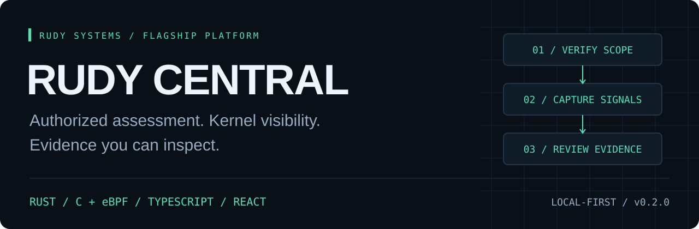
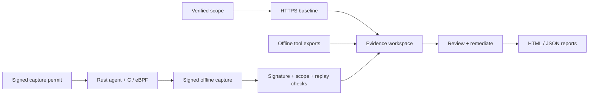

<p align="center"></p>

<p align="center"></p>

<p align="center"><strong>Define the scope. Follow the signals. Keep the evidence.</strong></p>
<p align="center"><a href="#overview">Overview</a> · <a href="#working-capabilities">Capabilities</a> · <a href="#start-locally">Quick start</a> · <a href="docs/ARCHITECTURE.md">Architecture</a> · <a href="docs/KERNEL.md">Linux sensor</a> · <a href="docs/VALIDATION.md">Validation</a></p>

---

## Overview

**Rudy Central is the flagship security workbench from [Rudy Systems](https://rudy.systems).** It brings authorized assessment, Linux kernel visibility, evidence review, and remediation into one local-first browser workspace.

A Rust host agent and restricted-C eBPF sensor collect bounded Linux telemetry. A TypeScript control plane verifies scope and signed captures, persists evidence in SQLite, and serves a responsive React investigation interface. The source is private; this is an early platform release.

**Version 0.2.0** adds host enrollment, Ed25519 capture permits, signed kernel evidence, and a process-event explorer alongside the web baseline, finding triage, reports, controls, audit chain, and 88-tool registry. Catalog entries describe integration capabilities; they do not mean those products are bundled or executable. Commercial licenses are not included.

## Built across the stack

| Layer             | Implementation            | Responsibility                                                              |
| :---------------- | :------------------------ | :-------------------------------------------------------------------------- |
| Kernel sensor     | Restricted C / Linux eBPF | Three fixed tracepoints, UID/time/event policy, bounded ring buffer         |
| Host agent        | Rust / libbpf             | Permit verification, probe loading, privilege drop, signed offline captures |
| Control plane     | TypeScript / Node.js      | Authorization, capture verification, finding workflow, local SQLite storage |
| Browser workbench | React / TypeScript        | Engagements, kernel event explorer, evidence, triage, controls, reports     |



[Explore the architecture](docs/ARCHITECTURE.md) · [Read the evidence contracts](docs/EVIDENCE.md)

## Working capabilities

| Area              | Implemented                                                                                                                           |
| ----------------- | ------------------------------------------------------------------------------------------------------------------------------------- |
| Workspace         | Operator and viewer sessions, local SQLite persistence, engagement filtering                                                          |
| Authorization     | DNS TXT or HTTPS challenge, 30-minute pending challenge, signed 24-hour exact-origin permit, revalidation, revocation                 |
| Native assessment | One HTTPS response; HSTS, CSP, content-type sniffing, framing, cookie flags, certificate expiry observations                          |
| Network boundary  | Public DNS origins on port 443; every answer checked; DNS pinned to socket; no redirects; bounded bytes and time                      |
| Evidence          | SARIF 2.1.0 subset, Semgrep JSON, Nuclei JSON/JSONL, Trivy JSON, Prowler OCSF JSON, normalized JSON, Rudy Linux snapshots             |
| Finding workflow  | Severity filtering, detail/evidence inspection, owner, notes, remediation status                                                      |
| Reports           | Downloadable HTML with print/PDF layout and JSON; evidence register and audit checkpoint                                              |
| Controls          | Per-engagement control records with review, implementation, and gap status                                                            |
| Audit             | HMAC-linked actions, integrity verification on startup, exported checkpoints                                                          |
| Linux posture     | Offline, unprivileged collection of selected kernel hardening settings                                                                |
| Kernel sensor     | Rust host agent; three embedded eBPF tracepoints; bounded ring buffer; UID/time/event limits inside the kernel; reader privilege drop |
| Kernel evidence   | Host/boot/key-bound Ed25519 permits, sensor-signed captures, replay protection, registry, revocation, searchable event explorer       |
| Tool library      | 88 catalog entries with documented native checks, export adapters, and reference-only tools; see the coverage guide                   |

## Start locally

Requires **Node.js 24.14+** and npm. Node's built-in SQLite API is experimental in the tested runtime; the application uses a small isolated storage module.

```sh
git clone https://github.com/r4venrudy/rudy-central.git
cd rudy-central
npm ci
npm run build
npm test
npm start
```

Open **http://127.0.0.1:4173**. The initial screen is an explicitly labeled synthetic demonstration. Select **Connect workspace** and use the key generated in `.data/admin-key`. For example, read it locally with `cat .data/admin-key` on Linux or `Get-Content .data/admin-key` in PowerShell. Do not send it to another service or commit it. Your connected workspace starts empty.

The server binds to loopback by default. To use a Linux engine from Windows, keep it bound to loopback and use an SSH tunnel:

```sh
ssh -L 4173:127.0.0.1:4173 your-user@your-linux-host
```

Then open the same localhost URL on Windows. An HTTPS reverse proxy is required for direct network exposure; see [deployment](docs/DEPLOYMENT.md).

## Run your first assessment

1. Connect to the real workspace and create an engagement with its objective and authorization reference.
2. Add an exact HTTPS origin you are authorized to assess. This release excludes IP literals, private networks, wildcard scopes, and nonstandard ports.
3. Publish the generated DNS TXT record or HTTPS text file. Verify ownership from the asset dialog.
4. Keep the proof published. Start the **Web security baseline** within your authorized testing window.
5. Review observations and evidence, import other authorized tool exports, triage findings, and export the report.

For evidence-only work, an engagement is sufficient: importing a file sends no assessment traffic. Sample exports are in [`examples/`](examples/). Do not mistake the sample fixtures for real results.

## Kernel boundary

The control plane runs unprivileged. The separately installed **Rust agent** loads three fixed Linux eBPF programs, then drops the reader to UID/GID 65534 with `no_new_privs`. It captures execution, exit, and connection-attempt metadata for one authorized UID. It collects no arguments, file contents, socket destinations, or packet payloads. No generic shell execution is exposed to the browser.

Both Rust and eBPF enforce bounded collection. The Node/TypeScript API verifies the signed capture and issued permit before saving it. **Real kernel collection and API ingestion passed on Linux 6.17.0-1022-azure**; broad kernel compatibility and sustained production performance are not established. Follow the [Linux sensor installation and capture guide](docs/KERNEL.md).

The current transport is an offline artifact. Revoking a host immediately blocks new permits and imports, but cannot interrupt an already authorized offline capture. Host signatures identify an enrolled key; they are not hardware attestation. Windows can run the UI/API and review Linux captures; it cannot load the Linux sensor.

## Development and verification

```sh
npm run check
npm run format:check
npm audit
cargo test --locked --manifest-path native/Cargo.toml
```

For Vite development, start the API with `RUDY_PUBLIC_ORIGIN=http://127.0.0.1:5173` and run `npm run dev` in another terminal. This explicitly trusts that local development origin. Production runs serve the compiled frontend and API from the same origin.

Web tests use in-memory databases and injected transport fixtures; no Internet targets are scanned. GitHub Actions checks the UI/API on Ubuntu and Windows, and compiles, loads, and exercises the Rust/eBPF agent on an owned ephemeral Linux runner. The kernel smoke test generates local processes and loopback connections, checks privilege drop, validates all three event kinds, exhausts a two-event budget, imports the signed artifact through the real API, and rejects replay. Successful kernel jobs package the tested Linux executable and a validation report as a downloadable Actions artifact.

## Documentation

- [Security model and limitations](SECURITY.md)
- [Architecture](docs/ARCHITECTURE.md)
- [Tool coverage and integration contracts](docs/TOOL-COVERAGE.md)
- [Deployment and key handling](docs/DEPLOYMENT.md)
- [Evidence formats](docs/EVIDENCE.md)
- [Release roadmap](docs/ROADMAP.md)
- [Verification record](docs/VALIDATION.md)

## Distribution

The source is private and no project license has been selected. Distribution and licensing terms remain the owner's decision. Third-party software retains its own license.

---

<p align="center"><strong>RUDY SYSTEMS</strong><br><a href="https://rudy.systems">rudy.systems</a> · <a href="https://github.com/r4venrudy">More work by Raven</a></p>
