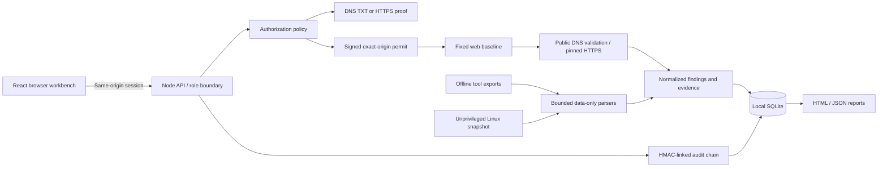

# Architecture

## Layout

| Path                   | Responsibility                                                                                         |
| ---------------------- | ------------------------------------------------------------------------------------------------------ |
| `src/`                 | Responsive UI, empty/demo states, dialogs, triage, filtering, report downloads                         |
| `server/app.mjs`       | HTTP routes, session/role checks, input validation, orchestration                                      |
| `server/security.mjs`  | Scope canonicalization, public-address policy, pinning, proof and permit verification, native findings |
| `server/store.mjs`     | SQLite storage, transactions, audit verification                                                       |
| `server/importers.mjs` | Data-only export normalization                                                                         |
| `server/catalog.mjs`   | Product registry; no executable command strings                                                        |
| `server/reports.mjs`   | Escaped, script-free report generation                                                                 |
| `sensors/`             | Offline posture collection; optional unvalidated eBPF example                                          |
| `tests/`               | Scope, race, API, role, importer, and evidence tests                                                   |

## Decisions

The engine is a user-space control plane. Network assessments do not become more complete merely by putting them in the kernel. Kernel visibility is useful for local host telemetry, so it gets a separate collection and privilege boundary.

The first native profile is deliberately deterministic: one response, fixed observations, no submitted commands or template execution. New executable integrations must implement a capability-specific scope contract; a catalog entry alone can never become a runnable tool.

SQLite fits an initial single-workspace deployment and makes reports/evidence durable without hosted services. Production multi-tenant operation requires a different identity and tenancy model, storage authorization, quotas, and isolated workers. Shared bearer role keys are not a substitute for SSO/MFA and per-user accountability.

Imported findings preserve source, raw artifact hash, and their original evidence file. Native observations retain measured metadata without persisting page bodies or cookie secrets. HMAC audit checkpoints can be anchored elsewhere; the product does not claim an immutable local database.

## Source references

- [Node.js SQLite API](https://nodejs.org/download/release/latest-v24.x/docs/api/sqlite.html)
- [DNS and HTTP ownership challenge patterns](https://letsencrypt.org/docs/challenge-types/) — inspiration only; this application is not an ACME implementation.
- [OASIS SARIF 2.1.0](https://www.oasis-open.org/standard/sarif-v2-1-0/)
- [Linux BPF LSM documentation](https://docs.kernel.org/bpf/prog_lsm.html)
- [bpftrace tracepoint examples](https://github.com/bpftrace/bpftrace/blob/master/docs/tutorial_one_liners.md)
