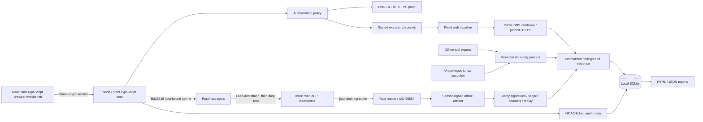

# Architecture

## Layout

| Path                       | Responsibility                                                                                         |
| -------------------------- | ------------------------------------------------------------------------------------------------------ |
| `src/`                     | Responsive UI, empty/demo states, dialogs, triage, filtering, report downloads                         |
| `server/app.mts`           | Typed HTTP routes, session/role checks, input validation, orchestration                                |
| `server/security.mts`      | Scope canonicalization, public-address policy, pinning, proof and permit verification, native findings |
| `server/store.mts`         | Typed SQLite records, transactions, audit verification                                                 |
| `server/kernel.mts`        | Kernel enrollment, Ed25519 authority, strict runtime schemas, capture acceptance and replay prevention |
| `native/src/`              | Rust CLI, signed permits, byte-safe event decoder, posture collection, Linux libbpf loader             |
| `native/bpf/`              | Fixed metadata-only tracepoint programs, UID/time/event policy, ring buffer and accounting             |
| `server/importers.mjs`     | Data-only export normalization                                                                         |
| `server/catalog.mjs`       | Product registry; no executable command strings                                                        |
| `server/reports.mts`       | Escaped, script-free report generation                                                                 |
| `sensors/`                 | Legacy unprivileged JavaScript posture collector                                                       |
| `scripts/kernel-smoke.mts` | Actual Linux kernel load, generated events, privilege drop, budget and API verification                |
| `tests/`                   | Scope, race, API, role, importer, and evidence tests                                                   |

## Decisions

The engine is a user-space control plane. Network assessments do not become more complete merely by putting them in the kernel. Kernel visibility is useful for local host telemetry, so it gets a separate collection and privilege boundary.

The kernel sensor uses a small restricted-C program compiled to eBPF and a Rust host agent. Only helper-derived metadata crosses the 48-byte event ABI. There is no kernel structure traversal or arbitrary probe/object input. The API and browser remain TypeScript; the old product registry, synthetic demo, and vendor export adapters remain JavaScript. Strict TypeScript checks cover the authorization, API, kernel protocol, persistence, report generation, and startup modules. Web HTTPS transport currently remains in the Node process; it is not a Rust network worker or an OS sandbox.

The sensor has its own Ed25519 identity. The workspace signs a permit binding host ID, boot ID, sensor key, UID, expiry and collection limits. The agent validates this against a separately installed authority key and its local identity, loads the embedded BPF object, applies map policy, attaches all probes, and drops privileges. The API independently verifies the signed artifact and consumes the permit transactionally. See [kernel guide](KERNEL.md) for the offline revocation and host-administrator trust boundary.

The first native profile is deliberately deterministic: one response, fixed observations, no submitted commands or template execution. New executable integrations must implement a capability-specific scope contract; a catalog entry alone can never become a runnable tool.

SQLite fits an initial single-workspace deployment and makes reports/evidence durable without hosted services. Production multi-tenant operation requires a different identity and tenancy model, storage authorization, quotas, and isolated workers. Shared bearer role keys are not a substitute for SSO/MFA and per-user accountability.

Imported findings preserve source, raw artifact hash, and their original evidence file. Native observations retain measured metadata without persisting page bodies or cookie secrets. HMAC audit checkpoints can be anchored elsewhere; the product does not claim an immutable local database.

## Source references

- [Node.js SQLite API](https://nodejs.org/download/release/latest-v24.x/docs/api/sqlite.html)
- [DNS and HTTP ownership challenge patterns](https://letsencrypt.org/docs/challenge-types/) — inspiration only; this application is not an ACME implementation.
- [OASIS SARIF 2.1.0](https://www.oasis-open.org/standard/sarif-v2-1-0/)
- [Linux BPF ring buffers](https://docs.kernel.org/bpf/ringbuf.html)
- [libbpf-rs](https://docs.rs/libbpf-rs/0.26.2/libbpf_rs/)
